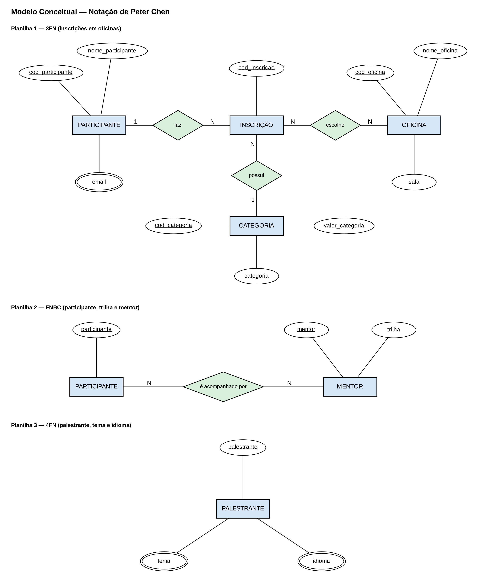

# Equipe 4: Semana de Tecnologia

**Nome do time:** ____________________

| Nome              | Usuário do GitHub |
| ---               | ---               |    
| Clecio Júnior     | @cleciofjur       |
| Denys Kauã        | @                 |
| Eluana Ferreira   | @                 |
| João Vitor        | @                 |
| Marcos Vínicius   | @mrvinicius25     |
| Raymond Barbosa   | @RaymondLima      | 
| Taís Yasmin       | @TaisSouz23       |

---

## O cenário

O sistema da Semana de Tecnologia hoje é uma planilha. Rode o `00_planilha.sql` no MySQL: ele cria o banco `normalizacao_eventos` com 3 tabelas que reproduzem a planilha (também em `planilha.xlsx`).

| Tabela | O que guarda |
| --- | --- |
| `planilha` | Cada linha é uma oficina escolhida em uma inscrição. Cada inscrição é de um participante e tem uma categoria de preço. |
| `planilha_fnbc` | Regra: em cada trilha, o participante tem um único mentor; cada mentor acompanha uma única trilha. |
| `planilha_4fn` | Cada palestrante fala sobre vários temas e em vários idiomas, sem relação entre tema e idioma. |

> Apague as instruções entre colchetes e preencha cada seção.

## 1. Anomalias

[Usando linhas reais da `planilha`, dê um exemplo de cada anomalia.]

| Anomalia | Exemplo na planilha |
| --- | --- |
| Inserção |  |
| Exclusão |  |
| Modificação |  |

## 2. Dependências funcionais da `planilha`

| Determinante | Determina | Tipo (total, parcial ou transitiva) |
| --- | --- | --- |
|  |  |  |

**Chave primária da `planilha`:** [ ]

## 3. Normalização passo a passo

**1FN:** [o que não era atômico e como ficou]

**2FN:** [quais dependências parciais e como ficou]

**3FN:** [quais dependências transitivas e como ficou]

**Esquema final em 3FN:** [Tabela(atributos), com PK sublinhada ou em negrito e FK indicada]

## 4. FNBC: `planilha_fnbc`

- Chaves candidatas: [ ]
- Dependência que viola a FNBC: [ ]
- Decomposição: [ ]
  
## 5. 4FN: `planilha_4fn`

<!-- BLOCO: PLANILHA 3 (4FN) - Pessoa 6 (Tais) -->
**Planilha original (8 linhas):**

| palestrante | tema | idioma |
| --- | --- | --- |
| Dra. Lia | IA | Português |
| Dra. Lia | IA | Inglês |
| Dra. Lia | Ética | Português |
| Dra. Lia | Ética | Inglês |
| Prof. Rui | Cloud | Português |
| Prof. Rui | Cloud | Espanhol |
| Eng. Tais | Segurança | Português |
| Eng. Tais | Redes | Português |

A chave da planilha é (palestrante, tema, idioma), ou seja, as três colunas juntas.

**Anomalias:**

| Anomalia | Exemplo na `planilha_4fn` |
| --- | --- |
| Inserção | Para acrescentar o idioma Espanhol à Dra. Lia, é preciso inserir 2 linhas (uma para IA e outra para Ética). Se esquecer uma, a planilha passa a dizer que ela fala Espanhol em só um dos temas. |
| Exclusão | Para remover o idioma Inglês da Dra. Lia, é preciso apagar 2 linhas, uma em cada tema. Apagar só uma deixa os dados inconsistentes. |
| Modificação | Para trocar o nome do tema Ética, é preciso alterar todas as linhas em que ele aparece (2 linhas só da Dra. Lia). |

- Dependências multivaloradas: `palestrante ->> tema` e `palestrante ->> idioma`. Cada palestrante tem um **conjunto** de temas e, de forma independente, um **conjunto** de idiomas. O idioma não depende do tema, e o tema não depende do idioma. Como o palestrante não é chave da planilha, essas dependências violam a 4FN. A planilha já está na FNBC, porque não há dependência funcional cujo determinante não seja chave. O problema é só a multivalorada, e a Dra. Lia mostra isso: 2 temas x 2 idiomas = 4 linhas.
- Decomposição: cada conjunto independente vai para a sua própria tabela, ligadas pela coluna `palestrante` (decisão da equipe: 2 tabelas, sem tabela `palestrante` separada, que não é necessária para atingir a 4FN).

| Tabela | Colunas | Chave primária | Linhas |
| --- | --- | --- | --- |
| `palestrante_tema` | palestrante, tema | (palestrante, tema) | 5 |
| `palestrante_idioma` | palestrante, idioma | (palestrante, idioma) | 5 |

Agora, para acrescentar um idioma à Dra. Lia, é preciso inserir só **1 linha**, em `palestrante_idioma`.
<!-- FIM DO BLOCO: PLANILHA 3 (4FN) -->

## 6. Modelagem

### 6.1 Modelo conceitual (Peter Chen)

[Entidades, atributos (identificador sublinhado; multivalorado com elipse dupla), relacionamentos com nome e cardinalidade (mín, máx).]



### 6.2 Modelo lógico (James Martin, pé de galinha)

[Todas as tabelas finais com seus atributos, PK e FK, e as linhas de relacionamento com a cardinalidade nas pontas.]


## 7. Dicionário de dados

Preencha o arquivo [`dicionario_dados.md`](dicionario_dados.md) com **todas** as tabelas finais.

## 8. Prova de junção sem perda

[Cole aqui o resultado do `03_prova_sem_perda.sql`: para cada planilha, linhas da original, linhas da reconstruída, faltando = 0 e sobrando = 0.]

```
(cole o resultado)
```

<!-- BLOCO: PLANILHA 3 (4FN) - Pessoa 6 (Tais) -->
**Planilha 3 (4FN):** `planilha_4fn` x JOIN de `palestrante_tema` com `palestrante_idioma`

```
linhas_originais | linhas_reconstruidas | faltando | sobrando
8                | 8                    | 0        | 0
```
<!-- FIM DO BLOCO: PLANILHA 3 (4FN) -->

## 9. Desafio: uma decomposição errada

[Mostre uma decomposição da `planilha_fnbc` que **perde** informação: as duas tabelas, a consulta de junção e quantas linhas falsas (tuplas espúrias) ela gera.]
